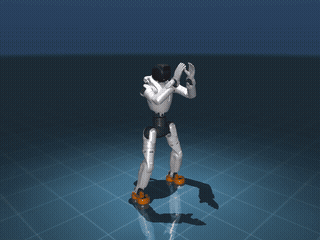
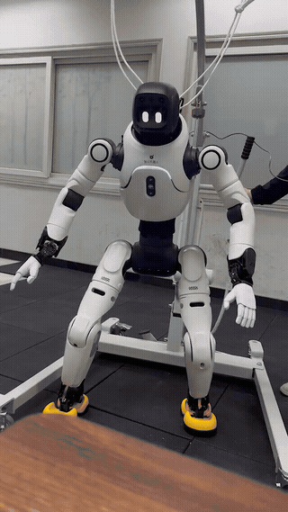

# X2 Ultra BeyondMimic Deploy

基于 ONNX Runtime 的 X2 Ultra 部署项目，支持 MuJoCo sim2sim 和 ROS 2 / AimDK sim2real。默认策略为 `assets/policy.onnx`，MuJoCo 场景为 `assets/x2_ultra/scene.xml`。

## Demo

### Sim2sim



[播放完整仿真视频](assets/sim.mp4)（约 99 秒）。

### Sim2real



[播放完整真机视频](assets/real.mp4)（约 90 秒）。

## Sim2sim

使用 Python 3.10+ 安装依赖并启动：

```bash
python -m venv .venv
.venv/bin/python -m pip install numpy mujoco onnx onnxruntime
.venv/bin/python scripts/sim2sim.py
```

motion 播放完自动退出。按空格暂停/继续，关闭窗口可提前结束；无窗口运行使用 `--headless`。可用 `--policy PATH` 指定 ONNX。

## Sim2real

真机部署需在 ROS 2 Humble 环境中运行，并加载 AimDK SDK。使用与 ROS 匹配的系统 Python（Humble 通常为 Python 3.10）；sim2sim 的 Python 3.13 虚拟环境不能用于 ROS 扩展。

```bash
source /opt/ros/humble/setup.bash
source /path/to/aimdk/install/local_setup.bash
python3 -m venv --system-site-packages .venv-real
.venv-real/bin/python -m pip install numpy onnx onnxruntime
```

运行前先在 PC1 停止原生运控，再从项目目录启动：

```bash
aima em stop-app mc
./deploy.sh
```

脚本等待终端确认后开始控制；确认前不会创建 HAL command publisher。也可在已加载 ROS 和 SDK 的终端直接运行 `.venv-real/bin/python scripts/sim2real.py`，并用 `--policy PATH` 指定策略。

真机以 50 Hz 推理并下发关节位置目标和 PD 参数，力矩由机器人底层控制器计算。IMU 使用 HAL 骨盆数据；原版 X2 的 `head_pitch` 槽位保留但不可控。HAL command topic 允许多个 publisher，脚本不检查控制权，因此启动前必须停止其他命令发布者。
